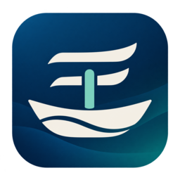

# 言舟 · YANVY

**免费、开源、离线优先的五笔与拼音输入法。**



让文字顺畅落下，让表达有自己的空间。

## 当前阶段

这是 **0.1.0-dev 开发工程**。已开始实现真实的 librime 输入核心，并用固定版本词库做自动验证。

**当前没有 Windows、Android 或 iPhone 正式版。** Windows x64 已有原生 TSF 开发测试包；维护者报告正在使用 `0.1.0-dev.1` 进行真实输入。本次 `0.1.0-dev.2` 优化候选窗与外观设置；完整的跨应用、安装升级卸载及多屏验收仍未完成，不能作为稳定日用版验收。`core/build/ime-core` 仍是开发诊断程序。验证范围见 [Windows 接续记录](docs/WINDOWS-DEV.md) 和 [本次 UI 记录](docs/UI-DEV2.md)。

| 能力 | 当前状态 |
| --- | --- |
| 工作名称与图标 | 已制作；名称仍需正式发行前复核 |
| 产品规划与开发路线 | 见 `docs/PRD.md`、`docs/ROADMAP.md` |
| 原生 C++ / librime 核心 | 已实现；当前 Linux 构建 42 项集成检查通过 |
| 五笔 86 与简体拼音候选、提交 | 已实现；具体证据以 `tests/results-core.json` 为准 |
| 默认不学习与配置保护 | 本轮功能与反例检查通过；原两项绕过及相邻缓存入口已独立复核 |
| Windows 系统输入法 / 安装包 | 已交付 dev.1 测试包并收到真实输入试用反馈；dev.2 改进原生 UI，代表应用矩阵尚未验收 |
| Android / iOS 原生键盘 | 后续阶段 |
| 九宫格、成熟整句纠错、本地自定义短语 | 后续阶段，不属于当前核心已验证功能 |
| GitHub 官方仓库 | 已创建公开仓库 [fengyuan0601-prog/yanvy-ime](https://github.com/fengyuan0601-prog/yanvy-ime)；当前为 `0.1.0-dev` 源码开发阶段 |

远程源码以官方仓库 `main` 的实际内容为准；CI 结果以 [GitHub Actions](https://github.com/fengyuan0601-prog/yanvy-ime/actions) 的实际运行记录为准。上面的42项来自原始 Linux 报告；GitHub Linux/Windows CI 的通过记录和实际边界另见发布与 Windows 接续记录。

五笔 86 是当前开发默认，不代表已经确认所有用户的五笔版本。五笔 98、新世纪方案按后续需求与许可核查分别加入。

## 产品原则

- 官方发行版免费使用、无广告，不要求登录。
- 输入转换和候选生成在本机完成，不上传输入内容，不做行为追踪。
- 第一批只提供不学习模式，不建立个人词频和输入历史。自愿开启的本地学习属于后续独立功能。
- 不加入广告、遥测、自动崩溃上传、云候选、后台剪贴板历史或运行期词库下载。
- 自愿赞助支持维护，不影响功能和更新资格；赞助入口在 GitHub/官网核实后配置。
- 一念开物 · IDEORIN 作为开发者品牌在项目页和关于页署名，输入过程不插入推广。

上述是官方产品原则；当前实际实现与未验证边界见 [隐私说明](PRIVACY.md)。第三方修改版由其发布者负责。

本轮完成内容、发现后修复的问题与证据范围见 [执行记录](docs/EXECUTION-REPORT.md)。GitHub 首次上传与维护安排见 [发布说明](docs/GITHUB-PUBLISH.md)。

## 开发者快速开始

当前已验证环境：Ubuntu 24.04 / x86_64，C++17，librime 1.10.0（Ubuntu 包 `1.10.0+dfsg1-2build2`）。构建依赖下载发生在开发环境，不是输入法运行功能。

```bash
sudo apt-get update
sudo apt-get install --no-install-recommends g++ librime-dev strace
python3 scripts/build_core.py
python3 tests/test_core.py
```

若使用解包的 Rime SDK，可传 `--rime-root /path/to/sdk-root`；执行程序时按脚本提示设置动态库搜索路径。测试环境和依赖来源见 `third_party/manifest.lock.json`。

准备一组全新的隔离数据目录：

```bash
python3 scripts/stage_data.py --shared-dir /tmp/yanvy-shared --user-dir /tmp/yanvy-user
core/build/ime-core /tmp/yanvy-shared /tmp/yanvy-user
```

诊断命令示例：

```text
schema pinyin_simp
keys nihao
key space
schema wubi86
keys wqvb
key space
quit
```

诊断程序会将当前编码、候选和提交结果写到标准输出，便于验证协议。**只用合成测试文本运行演示，不输入真实密码、聊天或个人资料，不把诊断输出当作正式产品日志保存。**

## 工程结构

| 目录 | 用途 |
| --- | --- |
| `core/` | 真实 librime 原生适配器与诊断程序 |
| `schemas/` | 固定输入方案与默认无学习补丁 |
| `third_party/` | 外部词库原始文件、许可证和版本锁 |
| `tests/` | 真实引擎、持久化与配置保护验证 |
| `scripts/` | 构建、隔离部署和资源导出工具 |
| `platforms/windows/` | 原生 TSF、Win32 候选窗、受限设置、离线引擎进程与开发安装包 |
| `platforms/android/`、`platforms/ios/` | 后续平台范围与限制 |
| `assets/brand/` | 生成的图标母版和确定尺寸导出 |
| `docs/` | 产品、路线、命名、品牌及开发交接文件 |

## 下一批工作

继续验证已有 Windows TSF 和安装包在记事本、浏览器、微信、Office/WPS 中的输入、取消组合、切换焦点、快捷键、不同 DPI，以及升级卸载行为。不要用网页输入框或诊断 CLI 代替系统输入法交付。

完整任务在 [开发交接](docs/CODEX-HANDOFF.md)。

## Windows 开发测试

首次源码发布与 Actions 记录见 [发布结果](docs/PUBLISH-RESULT.md)。Windows 构建、测试包限制及下一步实机检查见 [Windows 说明](platforms/windows/README.md) 和 [接续记录](docs/WINDOWS-DEV.md)。开发测试包未签名，仅供合成文本验证；尚无手机安装包。

## 参与与维护

主要维护者：GitHub 用户 `fengyuan0601-prog`。社区通过 Issue 和 Pull Request 参与；维护者决定官方版本方向。请先阅读 [贡献说明](CONTRIBUTING.md) 和 [安全报告说明](SECURITY.md)。

## 许可证

本仓库原创代码和文档采用 BSD-3-Clause，第三方资料保留各自许可证。**根目录许可不覆盖 `third_party/` 的上游文件，也不预先决定未来 GPL 平台前端的许可。** 见 [LICENSE](LICENSE) 和 [许可证索引](LICENSING.md)。

中文名“言舟”已检出其他软件生态中的数据库驱动用途；YANVY 也存在其他领域的使用。名称目前只是开发选定方案，未完成商标核准或域名注册。
