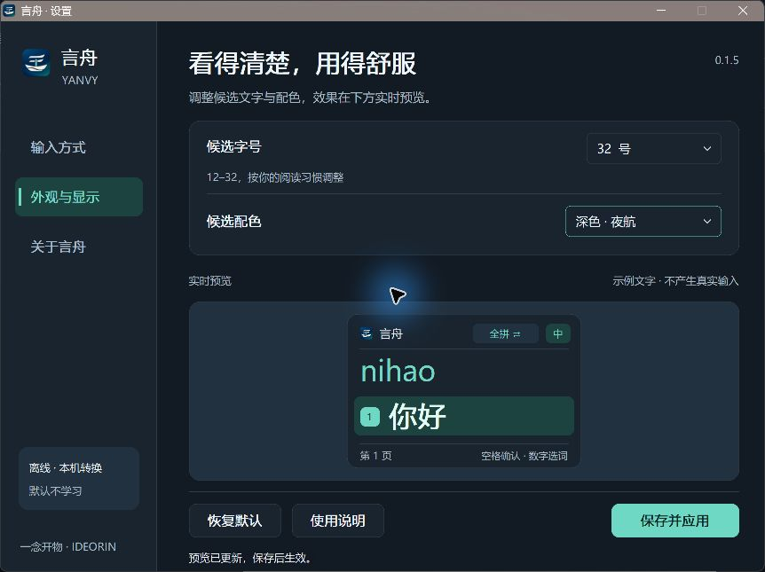
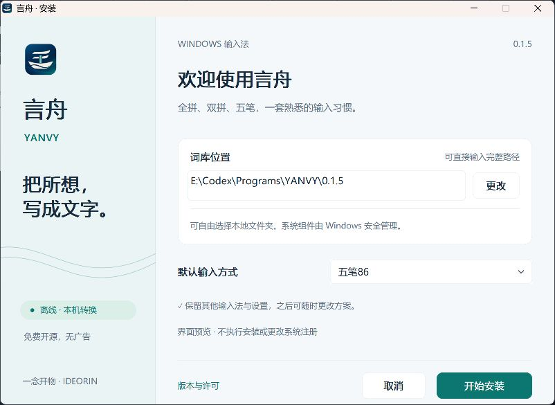

# 0.1.5 界面改进与验证

日期：2026-10-30。沿用言舟 · YANVY 品牌、离线引擎与现有原生输入路线。

正式交付补充：用户随后已安装 0.1.5 并反馈没有问题，同意正式交付；本机版本、74 项安装文件与新版引擎路径核对通过。见 [正式交付确认](RELEASE-0.1.5-ACCEPTANCE.md)。下文保留构建及自动化检查发生时的范围。

## 本轮改动

- 输入设置改为五张可直接选择的卡片：全拼、五笔86、小鹤双拼、自然码双拼和微软双拼。每张卡片展示用途、输入示例和明确的选中状态，取消原先的多层选择。
- 设置统一为清楚的导航、标题层级、卡片、间距与底部操作区；“云白”“夜航”配色覆盖整个设置窗口和候选预览，原生下拉框保留键盘及可访问性接口。
- 安装、安装中、完成、失败和卸载使用同一视觉体系。词库路径保持直接编辑和文件夹选择，说明系统组件与自选词库位置的区别。
- 候选窗沿用真实绘制器，统一颜色、序号、分隔线与选中状态；保留候选点击和方案切换的原有几何规则。
- 新增悬停与圆角焦点描边；Tab 和空格可操作原生控件，Ctrl+1/2/3 切换设置页，Ctrl+S 保存。
- 大窗口按当前屏幕可用区域限制显示比例，并在打开时居中；不改变保存的候选字号。
- 使用新的 TSF 身份加载新版界面，安装成功后按原有事务退役明确列出的五代旧身份。0.1.4 的受保护旧设置入口也纳入兼容恢复范围，不要求强制关闭其他应用。

## 真实窗口检查

本机 Windows 11 桌面实际运行同一设置实现的开发专用窗口，写入独立合成设置目录。检查了输入方式页、外观页、关于页和安装准备页。实际操作包括：

1. 从原生组合框选择 32 号字与夜航主题，观察候选预览和整体主题。
2. Ctrl+S 保存后核对独立设置文件确为字号 32、主题 2。
3. 用 Tab、Shift+Tab 和空格选择微软双拼，保存后核对 schema、pinyin_schema、double_schema 都为 4。
4. 关闭并重新打开窗口，确认选中的双拼与深色主题保留。
5. 分别在输入页和外观页恢复默认并保存，确认全拼、18 号、跟随系统和默认双拼偏好。
6. 安装准备页中直接编辑含中文的自选完整词库路径；本次窗口没有执行机器安装。

代表性真实运行截图：

## 自动检查与范围

18 组本机检查通过，覆盖 x64/x86 原生中英按钮与 TSF 模式往返、五代身份清理、注册修复、设置转接和受信启动、x86 COM ABI、x64 COM smoke、设置原子保存、候选边界、安装路径与真实核心回归。真实 librime 核心为 68 PASS、1 SKIP；网络追踪跳过项没有记为通过。

安装路径检查含无 E 盘的合成默认位置和 16 个边界。候选检查覆盖小工作区、12/18/32 号字及不同绘制比例。安装各状态及候选窗另按 96/144/192 DPI 调用真实绘制器输出图像；这种离屏绘制不等同于真实跨屏、系统缩放或系统安装验收。

本轮窗口操作通过键盘完成。自动化工具的坐标点击未能取得有效几何绑定，未将鼠标点击记录为通过。按钮仍使用 Windows 原生点击/键盘消息，同一处理路径的选择、保存和恢复已在实际窗口验证。

0.1.5 的真实管理员升级、装后任务栏操作、所有 DPI/跨屏组合及更广泛应用兼容性仍需按实际设备记录。此前 0.1.4 的安装、输入与右键确认见 [发布审计](RELEASE-AUDIT-2026-10-28.md)，不挪用为新版实装结论。安装包继续未签名，支持范围仍为 Windows 11 x64 桌面，包含 x86 TSF 组件。
